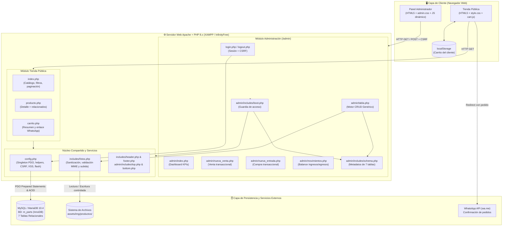
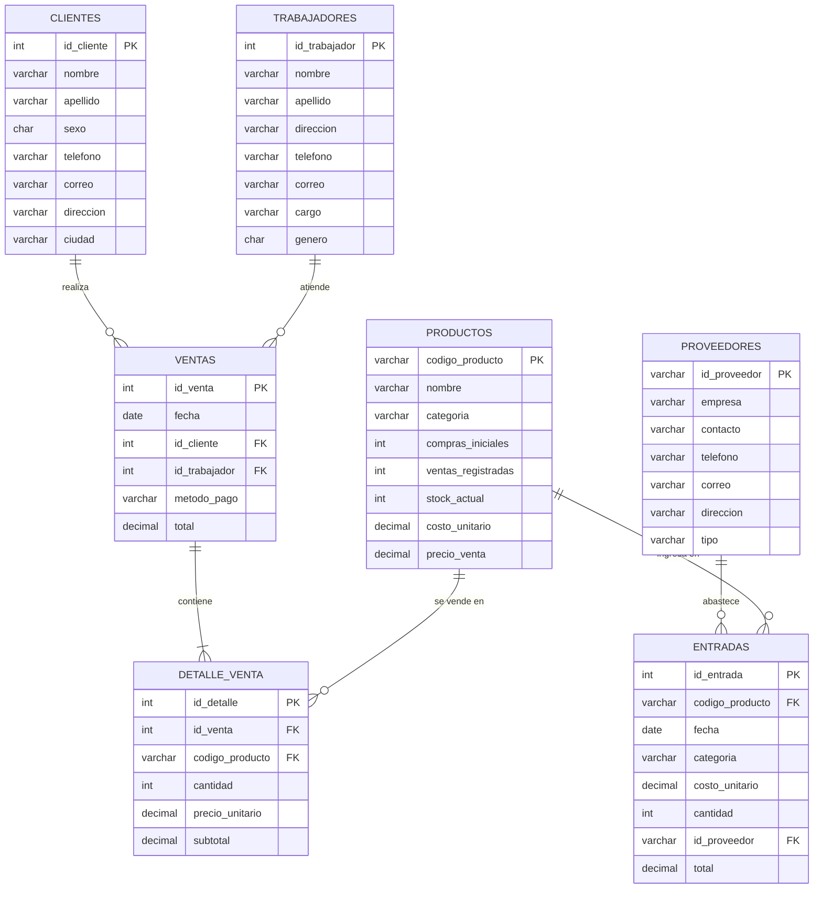
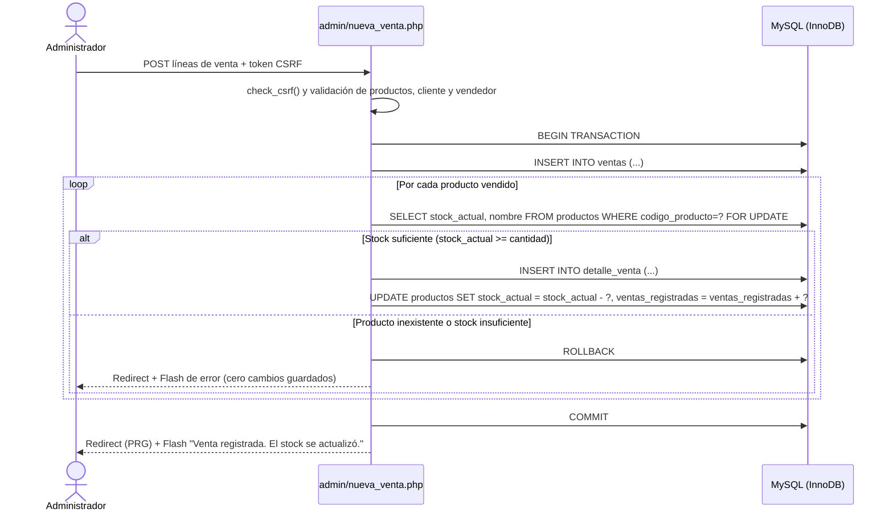

# 🏛️ Arquitectura del Sistema — M-PARTS

Este documento detalla las decisiones arquitectónicas, la organización modular en capas, el modelo de datos relacional, los flujos críticos de negocio y los mecanismos de seguridad implementados en **M-PARTS**.

---

## 1. Estilo y Patrón Arquitectónico

M-PARTS implementa una **Arquitectura Monolítica Modular Cliente-Servidor en Capas** basada en renderizado del lado del servidor (*Server-Side Rendering*, SSR) con **PHP nativo**, apoyada en tres patrones de diseño principales:

1. **Separación lógica en capas (Presentación, Control/Negocio, Servicios/Metadatos y Persistencia):** Aunque está construida en PHP puro sin frameworks externos, las responsabilidades están delimitadas entre vistas/componentes (`includes/`, `assets/`), controladores por caso de uso (`index.php`, `producto.php`, `carrito.php`, `admin/*.php`), utilidades transversales (`config.php`, `includes/fotos.php`) y acceso a datos con **PDO**.
2. **Patrón *Metadata-Driven CRUD* (CRUD dirigido por esquema):** En lugar de repetir formularios, listados y consultas SQL para cada entidad, el archivo `admin/includes/schema.php` centraliza la definición de las **7 tablas** (llave primaria, columnas visibles, campos buscables, tipos de dato y llaves foráneas). Un único motor (`admin/tabla.php`) interpreta ese esquema dinámicamente para administrar todo el sistema.
3. **Patrón Singleton para la conexión a base de datos:** La función `db(): PDO` en `config.php` mantiene una variable `static $pdo`, garantizando una única conexión activa por petición HTTP.

---

## 2. Diagrama de Arquitectura General

---

## 3. Desglose de Capas y Responsabilidades

| Capa | Archivos / Componentes | Responsabilidad Principal |
|---|---|---|
| **Presentación (Frontend)** | `assets/css/style.css`, `assets/css/admin.css`, `assets/js/cart.js`, `includes/header.php`, `includes/footer.php`, `admin/includes/top.php`, `admin/includes/bottom.php` | Interfaz adaptable, carrito en `localStorage`, cálculo instantáneo de subtotales en formularios y envío de pedidos a WhatsApp. |
| **Control y Lógica de Negocio** | `index.php`, `producto.php`, `carrito.php`, `admin/index.php`, `admin/tabla.php`, `admin/nueva_venta.php`, `admin/nueva_entrada.php`, `admin/movimientos.php`, `admin/login.php` | Validación de peticiones, control de sesión y CSRF, reglas de inventario (descuento/aumento de stock), cálculos financieros y patrón PRG (*Post/Redirect/Get*) con mensajes *flash*. |
| **Servicios Transversales y Metadatos** | `config.php`, `includes/fotos.php`, `admin/includes/boot.php`, `admin/includes/schema.php` | Conexión Singleton PDO, formato COP, normalización de categorías/títulos, estados de stock, validación segura de imágenes y definición declarativa de las 7 tablas. |
| **Persistencia de Datos** | Base de datos `m_parts` (MySQL/MariaDB InnoDB) y carpeta `assets/img/productos/` | Almacenamiento relacional con integridad referencial (PK/FK), transacciones ACID con bloqueo de filas y almacenamiento de fotografías por código de producto. |

---

## 4. Modelo de Base de Datos (`m_parts`)

Motor **InnoDB** con codificación **`utf8mb4`**, compuesto por **7 tablas relacionales**:

| Tabla | Llave Primaria | Generación de ID | Registros base | Función |
|---|---|---|---|---|
| `productos` | `codigo_producto` | Manual (ej. `A001`) | 195 | Catálogo maestro, existencias, costo unitario y precio de venta. |
| `clientes` | `id_cliente` | Manual (Documento) | 46 | Directorio de clientes para facturación. |
| `proveedores` | `id_proveedor` | Manual | 7 | Proveedores de repuestos y mercancía. |
| `trabajadores` | `id_trabajador` | Manual (Documento) | 8 | Personal y vendedores asociados a las ventas. |
| `entradas` | `id_entrada` | Secuencial (`next_id`) | 195 | Compras de mercancía e ingresos al inventario. |
| `ventas` | `id_venta` | Secuencial (`next_id`) | 100 | Encabezado de ventas (fecha, cliente, vendedor, pago, total). |
| `detalle_venta` | `id_detalle` | Secuencial (`next_id`) | 100 | Líneas de repuestos vendidos, cantidad, precio y subtotal. |

### Diagrama Entidad-Relación (ER)

---

## 5. Flujo Crítico: Transacción ACID de Registro de Venta

Para evitar ventas sin inventario o inconsistencias por peticiones simultáneas, `admin/nueva_venta.php` ejecuta toda la operación dentro de una **transacción SQL** con bloqueo pesimista (`SELECT ... FOR UPDATE`):

---

## 6. Reglas de Negocio y Consultas Analíticas

- **Utilidad bruta estimada (`admin/index.php`):** `SUM(d.subtotal - d.cantidad * p.costo_unitario)`.
- **Valoración del inventario (`admin/index.php`):**
  - A costo: `SUM(stock_actual * costo_unitario)`
  - A precio de venta: `SUM(stock_actual * precio_venta)`
- **Limpieza no destructiva (`CAT_SQL` en `config.php`):** `REPLACE(categoria,'RESPUESTOS','REPUESTOS')` corrige el error tipográfico en consultas y filtros sin modificar los datos históricos en la base de datos.
- **Flujo de caja unificado (`admin/movimientos.php`):** Combina `entradas` (egresos) y `ventas` (ingresos) con `UNION ALL` para calcular balance neto filtrable por tipo y rango de fechas.

---

## 7. Arquitectura de Seguridad

| Amenaza | Mitigación Implementada | Ubicación |
|---|---|---|
| **Inyección SQL (SQLi)** | Consultas preparadas PDO (`prepare`/`execute`) y listas blancas para ordenamiento (`$orderBy`) y nombres de tabla (`isset($S[$t])`). | `index.php`, `producto.php`, `admin/tabla.php`, `admin/nueva_venta.php`, `admin/nueva_entrada.php`, `admin/movimientos.php` |
| **Cross-Site Scripting (XSS)** | Escape de salida con `h()` (`htmlspecialchars(..., ENT_QUOTES, 'UTF-8')`) y banderas seguras en `json_encode()`. | `config.php`, vistas públicas/admin y `admin/nueva_venta.php` |
| **CSRF** | Token criptográfico por sesión (`random_bytes(16)`), `csrf_field()` y comparación en tiempo constante (`hash_equals`) en `check_csrf()` con estado HTTP `419`. | `config.php` y todos los formularios POST de `/admin` |
| **Fuerza bruta / Secuestro de sesión** | `session_regenerate_id(true)` al iniciar sesión, `hash_equals()` en credenciales y retardo `sleep(1)` tras fallo. | `admin/login.php`, `admin/logout.php`, `admin/includes/boot.php` |
| **Subida insegura / Path Traversal** | Sanitización de nombres con `foto_codigo()` (`/[^A-Za-z0-9_-]/`), validación real de contenido MIME mediante `getimagesize()` (JPG, PNG, WEBP) y límite de 3 MB. | `includes/fotos.php` |
| **Exposición de credenciales** | Separación entre `config.example.php` (público) y `config.php` (excluido en `.gitignore`). | `.gitignore`, `config.example.php` |

---

## 8. Arquitectura de Despliegue

1. **Desarrollo Local (XAMPP):** Apache + PHP 8.x + MariaDB (`localhost`, BD `m_parts`).
2. **Producción (InfinityFree):** Hosting compartido PHP/MySQL accesible en `https://mparts-fesc.free.je/mparts/?i=1`, utilizando el mismo código base con su propio `config.php`.
